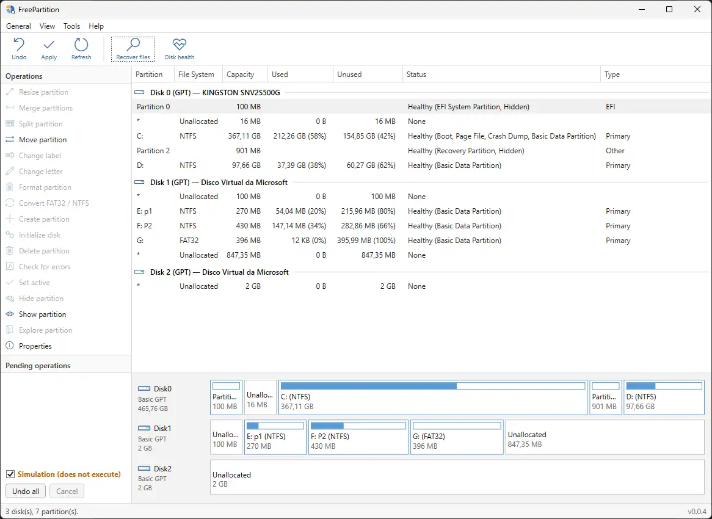
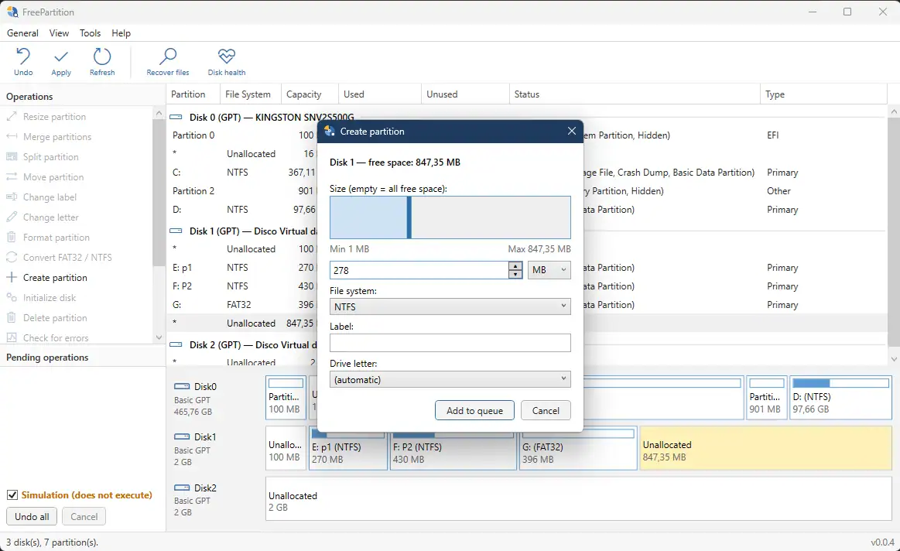
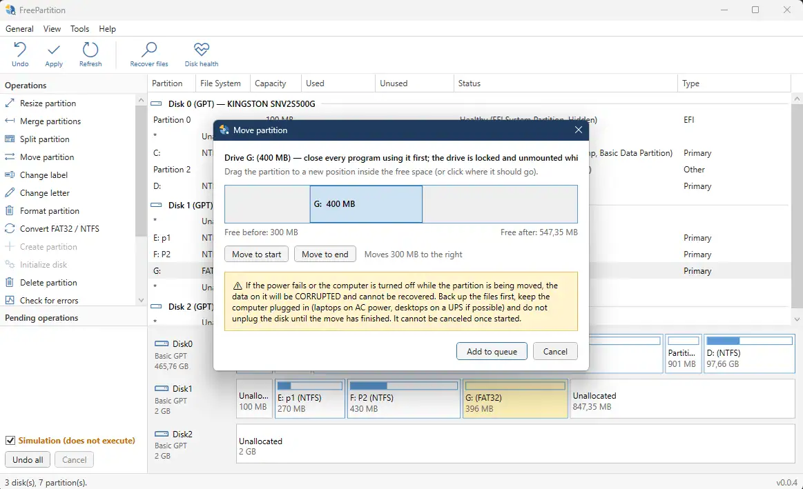
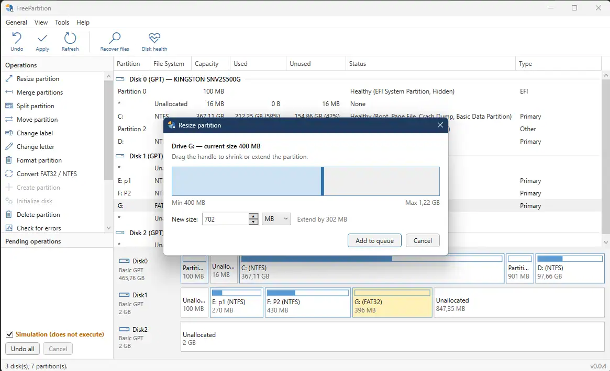
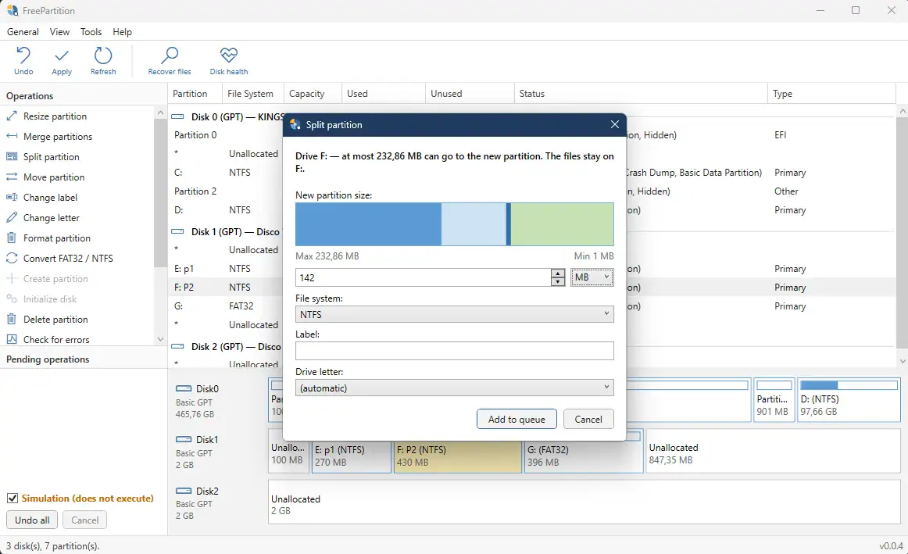
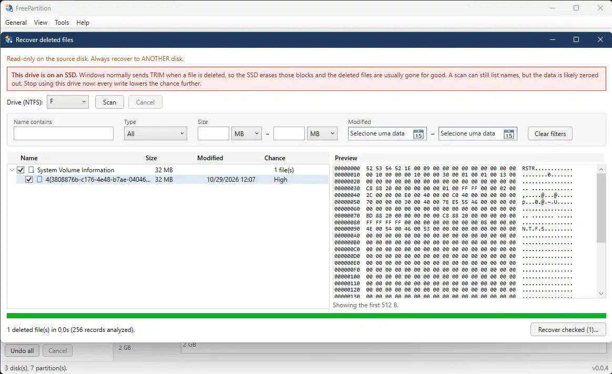
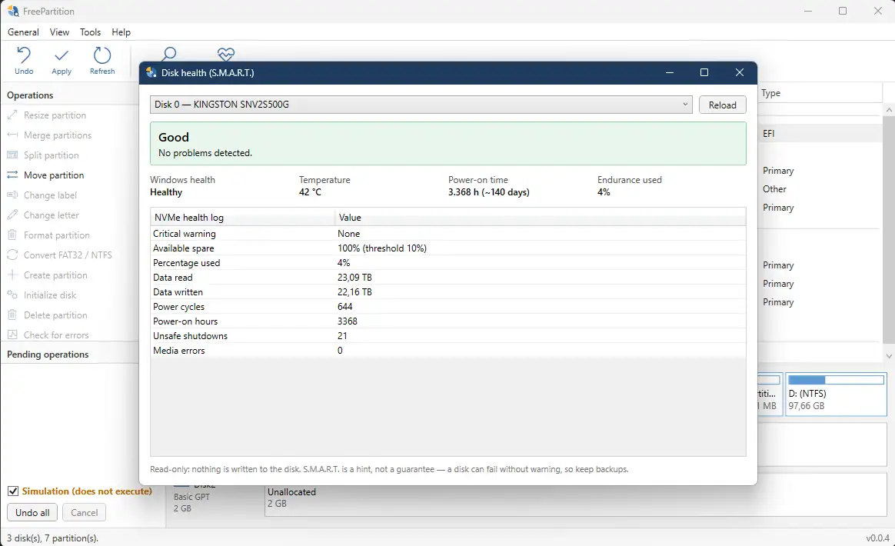

<h1 align="center"> FreePartition</h1>

<p align="center">
  <b>Free, open-source disk management for Windows. No ads.</b><br>
  Recover deleted files and manage your partitions, all in one app.
</p>

- **File recovery:** scan NTFS volumes for deleted files, or carve JPEG, PNG, PDF, DOCX, MP4 and more by signature on
  FAT, exFAT and damaged NTFS. Preview what you found, browse every photo as a thumbnail gallery, check the ones you
  want and recover them to another drive, never the one you are scanning.
- **Partitions:** create, resize, move, merge, split and format partitions with a visual disk map and a
  review-then-apply queue, so nothing touches your disk until you confirm.
- **Disk health:** read-only S.M.A.R.T. and NVMe health reports.
- **Clone Windows:** from the bootable WinPE build, copy an installed Windows to another disk in one guided window,
  boot files and recovery partition included.
-  Built with C# / .NET and WPF.

<p align="center">
  
  
  
  <a href="https://github.com/rfiori/FreePartition/releases"></a>
  <a href="LICENSE"></a>
  <a href="https://github.com/rfiori/FreePartition/releases"></a>
</p>

---

## Download

1. Open the [latest release](https://github.com/rfiori/FreePartition/releases/latest) and download one of the zips:
   - `FreePartition-<version>-win-x64-self-contained.zip`: runs without installing anything (recommended).
   - `FreePartition-<version>-win-x64.zip`: smaller, needs the [.NET Desktop Runtime 10](https://dotnet.microsoft.com/download).
2. Extract it and run `FreePartition.exe`. Accept the administrator prompt: raw disk access needs it.

Requires Windows 10 / 11 (64-bit). To copy Windows to another disk you also need a USB drive: see
[Clone Windows to another disk](#clone-windows-to-another-disk).

- **SmartScreen:** the builds are not code-signed yet, so Windows may warn on the first run. Click **More info** and
  then **Run anyway**.
- **Check your download** (optional): run `Get-FileHash <file>.zip -Algorithm SHA256` in PowerShell and compare the
  result with `SHA256SUMS.txt`, attached to the same release.

## Table of contents

- [Download](#download)
- [File recovery](#file-recovery)
- [What it does](#what-it-does)
- [Clone Windows to another disk](#clone-windows-to-another-disk) (with a [step-by-step guide](docs/clone-windows/GUIDE.md))
- [Screenshots](#screenshots)
- [How to try it safely (test VHD)](#how-to-try-it-safely-test-vhd)
- [How recovery works](#how-recovery-works)
- [Safety](#safety)
- [Roadmap](#roadmap)
- [Known limitations](#known-limitations)
- [Build from source](#build-from-source)
- [Contributing](#contributing)
- [License](#license)

## File recovery

**Tools → Recover deleted files** is the main feature of FreePartition. Pick a drive and scan it; the source is only
ever read, and files are always recovered to **another** drive.

| Step | What you get |
| --- | --- |
| **1. Scan** | **NTFS:** reads the MFT and lists deleted files with their original names and folders, plus a recovery chance for each. **FAT / exFAT / damaged NTFS:** *carves files by signature*, searching the whole drive for known formats (JPEG, PNG, GIF, BMP, WebP, PSD, PDF, DOCX/XLSX/PPTX, ZIP, 7z, MP4/MOV/HEIC, WAV, AVI, SQLite, EXE/DLL). You can also force carving on NTFS. |
| **2. Filter** | By name, type (pictures, documents, audio, video, archives), size and modified date. |
| **3. Preview** | Select any file, carved or not, to see it before recovering: the image, the text, or a hex dump. Nothing is written anywhere. |
| **4. Thumbnails** | **Thumbnails…** opens a window with every image in the list (respecting the filters) as a thumbnail, so you do not have to click them one by one. Click a thumbnail to check it, **drag** across several to check or uncheck them all, or **Shift+click** to take a whole range. Programs (EXE, DLL, SCR, OCX, CPL) show their own **application icon**, read from the file's resources in memory. A slider changes the thumbnail size. |
| **5. Recover** | Check the files and recover them to a folder on another drive. NTFS files keep their original folders; carved files are grouped by type. |

Carving is the way to get photos and documents back from a formatted memory card or USB stick, where no file names
survive: scan, open **Thumbnails…**, check the pictures you recognize and recover them. See
[How recovery works](#how-recovery-works) for the details and limits.

## What it does

Everything in the **Operations** panel (and the right-click menu, which mirrors it) and the **Tools** menu is listed below. Nothing that changes a disk runs until you click **Apply**.

### Overview

| Area | Feature |
| --- | --- |
| **Disks and partitions** | Lists disks, partitions and volumes through WMI, grouped by disk with a graphical map. Tells SSDs from HDDs, flags partitions that are not aligned to 4 KB and draws the hidden Microsoft Reserved (MSR) partition as *Reserved (MSR)* instead of unallocated space. |


### Operations

**Inspect** (read-only)

| Operation | What it does |
| --- | --- |
| **Explore partition** | Opens the selected partition in Windows Explorer. |
| **Properties** | Usage bar (used/free, and on a drive with Windows the estimated share of the operating system, programs and users) plus partition, NTFS volume and disk details. |
| **Verify wipe** | Reads a whole volume (also a RAW one) and checks that nothing is left after a wipe: counts the bytes that are not zero, shows where the first one is with a hex dump and names any NTFS / exFAT / FAT32 signature that survived. Verdict: all zeros, random-looking, residual data or inconclusive. |
| **Cluster map** | Draws a whole volume (also a RAW one) as a grid. Each square is classified as zero, data or unreadable from three 4 KB samples; clicking a square shows its byte range, its NTFS clusters and a hex dump. |
| **Recover files** | Looks for deleted files on the selected NTFS drive, or carves files by signature on FAT/exFAT and damaged NTFS, with preview and a thumbnail gallery (see [File recovery](#file-recovery)). |
| **Recover partitions** | Looks in the unallocated space of the selected disk for NTFS, FAT32 and exFAT partitions missing from the partition table (read-only) and queues the ones you check to be put back. Only the table is written, never the files (see below). |

**Create**

| Operation | What it does |
| --- | --- |
| **Initialize disk** | Initializes a blank disk as MBR or GPT. |
| **Create partition** | Creates a partition in the selected unallocated space, formatted as NTFS, FAT32 or exFAT, with a label and drive letter. |

**Size and position**

| Operation | What it does |
| --- | --- |
| **Resize partition** | Extends or shrinks the selected partition by dragging the partition bar. |
| **Move partition** | Moves the partition into free space on the same disk (data is lost if interrupted). |
| **Align partition** | Moves a partition that is not aligned to 4 KB to the nearest 1 MB boundary (data is lost if interrupted). |
| **Clone partition** | Copies the selected partition, sector by sector, into unallocated space on the same or another disk, and adds it to that disk's partition table. The original is only read and is not changed. |
| **Merge partitions** | Merges the selected partition into the one right before it; its files are kept in a folder. |
| **Split partition** | Splits the selected partition in two, using its free space, by dragging the bar. The files stay on the original drive. |

**Settings**

| Operation | What it does |
| --- | --- |
| **Change label** | Changes the volume label. |
| **Change letter** | Changes the drive letter. |
| **Convert FAT32 / NTFS** | Converts the selected partition between FAT32 and NTFS, keeping its files. |
| **Convert MBR / GPT** | Converts the selected disk between MBR and GPT, keeping every partition and its files: only the partition table is rewritten (see below). |
| **Set active** | Marks the selected MBR partition as active (bootable). |
| **Hide partition** | Removes the drive letter; the data stays untouched. |
| **Show partition** | Gives a drive letter to a hidden partition. |

**Maintenance**

| Operation | What it does |
| --- | --- |
| **Check for errors** | Checks the selected volume for file system errors with `chkdsk` (scan or repair). |

**Destructive**

| Operation | What it does |
| --- | --- |
| **Format partition** | Formats the partition as NTFS, FAT32 or exFAT. Erases all data on it. |
| **Delete partition** | Deletes the partition. Erases all data on it. |
| **Wipe free space** | Overwrites the free space of the selected drive so deleted files cannot be recovered. The files are kept. |
| **Wipe partition** | Overwrites every sector of the selected partition so nothing on it can be recovered. |
| **Wipe disk** | Deletes every partition of the selected disk and overwrites all of its sectors. |

### Tools

| Tool | What it does |
| --- | --- |
| **Recover deleted files** (Tools menu and toolbar) | MFT scan of NTFS volumes: original path, recovery chance (cross-checked against `$Bitmap`, and marked *Overwritten (zeros)* when the start, middle and end of the file are all zeros, as after a wipe; those files cannot be checked for recovery) and recovery to another drive. Results are a folder tree with check boxes that recreates the original folders, with filters by name, type, size and modified date, a read-only preview (image, text or hex dump) of the selected file and a **Thumbnails…** gallery of all the images (click, drag or Shift+click to check them). Also carves files by signature. Shows a TRIM warning when the drive is on an SSD. |
| **Disk health (S.M.A.R.T.)** (Tools menu and toolbar) | Read-only report per disk: overall level, temperature, power-on time and wear, with the ATA S.M.A.R.T. attribute table or the NVMe health log. |
| **Clone Windows to another disk** (Tools menu and toolbar) | Copies an installed Windows to another disk so the new disk boots on its own: initializes the destination, creates the boot partition, copies Windows and the recovery partition and writes the boot files. Runs only from the [WinPE build](tools/winpe/README.md), where the source Windows is not in use; in a normal Windows it shows how to download the WinPE ISO from the [releases page](https://github.com/rfiori/FreePartition/releases/latest) and make the bootable USB drive (see [below](#clone-windows-to-another-disk)). |

Not implemented yet: SSD firmware Secure Erase. See the [Roadmap](#roadmap).

## Clone Windows to another disk

> **First time?** Follow the step-by-step guide, written for non-technical users, with the problems you may meet and
> how to solve them: [English](docs/clone-windows/GUIDE.md) · [Español](docs/clone-windows/GUIDE.es.md) ·
> [Português (Brasil)](docs/clone-windows/GUIDE.pt-BR.md).

Windows cannot be copied consistently while it is running, so the clone runs only when FreePartition runs from
the [WinPE build](tools/winpe/README.md) (the app detects it). In a normal Windows the same button opens a window that
explains how to get there:

1. Download the ready-made WinPE image:
   **`FreePartition-WinPE.iso`**, attached to the [latest release](https://github.com/rfiori/FreePartition/releases/latest)
   (or build it yourself with [`build-winpe.ps1`](tools/winpe/README.md)).
2. Write it to a USB drive of 4 GB or more (it is erased): with [Rufus](https://rufus.ie), partition scheme MBR
   (target BIOS or UEFI) and file system FAT32; with [Ventoy](https://www.ventoy.net), just copy the ISO to the drive.
3. Connect the destination disk, shut Windows down completely and start the PC from the USB drive (boot menu, usually
   F12, F11, F8 or Esc), in UEFI mode for a UEFI Windows or BIOS mode for a BIOS one.

FreePartition opens by itself. Use **Tools → Clone Windows to another disk…** or the **Clone Windows** toolbar button.
A single window guides you and shows each step with its status (*OK*, *Skipped* or *Failed*):

| Step | What it does |
| --- | --- |
| **1. Check the disks** | The destination must be a different disk, large enough for the boot partition, Windows and the recovery partition. |
| **2. Erase and initialize** | Wipes the destination disk and initializes it as GPT (UEFI source) or MBR (BIOS source). |
| **3. Create the boot partition** | EFI system partition plus MSR on GPT; an active *System Reserved* partition on MBR. |
| **4. Copy the Windows partition** | Sector by sector, the same copy as **Clone partition**. |
| **5. Copy the recovery partition** | Creates it, copies its files and points the copied Windows to it (`reagentc`). Skipped when the source has none; a failure here is only a warning, which tells you to run `reagentc /enable` in the new Windows if needed. |
| **6. Write the boot files** | `bcdboot`; if it refuses the copy (for example Windows 7 from a recent WinPE), the source's own boot files are copied and its boot store is repointed to the new disk. |
| **7. Verify the result** | Checks that the boot loader and the boot store exist and that the default entry points to the copy. |

- The **destination disk is erased**; the source is only read. You must tick a confirmation before it starts.
- The copy has the exact size of the Windows partition: for a smaller destination, shrink the Windows partition first.
- Windows must have been shut down completely (Fast Startup leaves a half-saved session; `hiberfil.sys` is also removed
  from the copy).
- A GPT source needs the computer in UEFI mode, an MBR source in BIOS (legacy) mode.
- To test the result, disconnect the old disk and start from the new one.

Details and requirements: [tools/winpe/README.md](tools/winpe/README.md).

## Screenshots



<table>
  <tr>
    <td></td>
    <td></td>
    <td></td>
  </tr>
  <tr>
    <td></td>
    <td></td>
    <td></td>
  </tr>
</table>

## How to try it safely (test VHD)

Run in an **elevated** PowerShell. This creates a throwaway 2 GB NTFS disk you can scan,
format and delete files on without risking real data:

```powershell
$vhd = "$env:USERPROFILE\FreePartition-test.vhdx"
@"
create vdisk file="$vhd" maximum=2048 type=expandable
select vdisk file="$vhd"
attach vdisk
convert gpt
create partition primary
format fs=ntfs label=FreePartition_TEST quick
assign
"@ | diskpart
```

Copy some files to the new drive, delete them, then scan that volume in FreePartition.
When you are done, detach the disk and delete the file:

```powershell
@"
select vdisk file="$vhd"
detach vdisk
"@ | diskpart
Remove-Item $vhd
```

> This uses `diskpart`, which ships with Windows, so nothing extra needs to be installed.
> You can also create the VHD from **Disk Management → Action → Create VHD**.

## How recovery works

1. Reads the boot sector → cluster size and where the MFT starts.
2. Reads record 0 (`$MFT`) and follows its *data runs*, so a fragmented MFT works too.
3. For each record: applies the *fixups*, reads `$FILE_NAME` (name and parent folder) and
   `$DATA`. Records without the "in use" flag are deleted files.
4. Rebuilds the original path from the parent folders (in use or deleted).
5. Cross-checks the file's clusters against `$Bitmap`: clusters still free = data probably intact.
6. Recover = copy the clusters (or the content resident in the MFT) to a file on **another disk**.

### File carving

The **Carve files by signature** option ignores the file system and walks the whole volume looking for the bytes each
format starts with, then works out where each file ends from its own structure. Supported: JPEG, PNG, GIF, BMP, WebP,
PSD/PSB, PDF, DOCX/XLSX/PPTX, ZIP, MP4, MOV, M4A, 3GP, HEIC, AVIF, WAV, AVI, 7z, SQLite and EXE/DLL.

It is on by default for FAT/exFAT drives, and the scan switches to it by itself when the NTFS MFT cannot be read.

- Carved files can be previewed like any other, and the **Thumbnails…** gallery shows all carved images at once
  (JPEG, PNG, GIF, BMP; images over 16 MB and formats Windows cannot decode show a placeholder).
- A carved or deleted **EXE/DLL** shows its icon in the gallery and above its hex dump in the preview. Programs without an
  icon, over 32 MB, or cut by fragmentation show "No icon". The list itself still uses one generic icon.
- Files come back as `carved_00001.jpg`, grouped by type, without names, folders or dates.
- A fragmented file is cut at the first gap, so it may be incomplete or damaged.
- Files whose end has to be searched for (JPEG, PNG, GIF, PDF, ZIP) are skipped past 256 MiB; formats that state their
  own size go up to 16 GiB.
- It reads the entire drive, so it is much slower than the MFT scan (still read-only). **Cancel** lists what was found so far.

### Lost partitions

**Recover partitions** finds partitions whose entry is gone from the partition table (a deleted partition, a corrupted
table, a disk that shows as uninitialized):

1. Looks in the unallocated ranges of the disk for the boot sector of an NTFS, FAT32 or exFAT volume, and keeps only
   partitions that fit entirely in the free space.
2. A partition whose backup boot sector (at the end of the volume) also matches is **high confidence** and checked by
   default; one with only the first boot sector is **low confidence** and left unchecked.
3. **Add to queue** queues a *Restore partition* for each checked result. On **Apply** it re-checks the boot sector and
   that nothing else occupies the range, then writes the table entry directly (`New-Partition` would zero the start
   of the partition and destroy the boot sector). The volume is **not formatted**, so its files come back as they were.

- **Quick** looks where partitions usually start (start of each free range, every 1 MB, sector 63); **Deep** reads
  every sector of the free space, so it takes as long as copying that space.
- On a disk with no partition table, queue **Initialize disk** first, then the restores.
- Only the partition comes back, not its type or GUID: Windows gives it a new GPT GUID and a basic data type.

## Safety

The guarantees the code is built around:

- Volumes are opened **read-only** for scans and recovery; recovery **refuses a destination on the same drive**.
- Disk operations never run directly: they go into a queue and only run on **Apply**, after a confirmation that lists
  the risk. **Simulation mode is on by default** and only shows the commands. **Undo** works only before applying.
- The **Windows drive** is protected: no format, letter change, move, clone or wipe. *Wipe disk* and *Convert MBR / GPT*
  are also refused on any disk holding Windows or the app itself (checked by the queue, by the script and again right
  before writing, failing closed if the disk cannot be identified).
- PowerShell scripts are generated only from validated values (drive letter, numeric size, file system from a closed
  list, label with restricted characters) — no command injection.
- The few operations that write below the cmdlet level (**Move**, **Clone**, **Restore partition**, **Convert MBR / GPT**
  and the **wipes**) only run after **Apply**, check the partition table first and write only where they must: inside the
  partition's own locked volume, into free space of the disk, or the partition table sectors. Clone and Restore write the
  table entry last; Convert saves the old table and puts it back if writing fails.
- **Move partition cannot be canceled once the copy starts, and a power failure corrupts that partition** — the app says
  so before and when applying. On SSDs, wipes cannot reach the drive's spare cells and the app warns about it.
- The queue stops at the first failure; the remaining operations stay pending.
- Every event is logged to `Log\operations.log` next to the executable (or `%LocalAppData%\FreePartition\operations.log` if that folder is not writable).

## Roadmap

**Basic**
- ✅ List disks, partitions and volumes
- ✅ Format (NTFS, FAT32, exFAT)
- ✅ Shrink and extend partition
- ✅ Change drive letter and label
- ✅ Create and delete partition
- ✅ Initialize disk (MBR/GPT)
- ✅ Set active partition, hide/show
- ✅ Explore partition and Properties (usage breakdown; partition, volume and disk details)
- ✅ Disk health (S.M.A.R.T. for ATA disks, health log for NVMe)

**Intermediate**
- ✅ Pending-operations queue (Apply/Undo)
- ✅ Operations log
- ✅ Merge and split partitions
- ✅ Convert FAT32 ↔ NTFS without data loss
- ✅ Check for errors (`chkdsk`; scan or repair)
- ✅ Detect partitions not aligned to 4 KB (warning on the disk map and in Properties)
- ✅ Align a partition to 1 MB (moves it to the nearest boundary; same risk as a move)
- ✅ Wipe a partition, a whole disk or a drive's free space (zeros, verified zeros or random data)
- ✅ Verify wipe (reads a whole volume and reports any data or file system signature left)
- ✅ Cluster map (a volume drawn as a grid of zero, data and unreadable areas, with a hex dump per square)

**Data recovery**
- ✅ Find deleted files (MFT scan, NTFS)
- ✅ Recovery chance estimate
- ✅ Always recover to another disk
- ✅ Filter by name
- ✅ Filters by type, size and date; preview before recovering (image, text or hex dump)
- ✅ File carving by signature (JPEG, PNG, PDF, DOCX…) for FAT/exFAT or a damaged MFT
- ✅ Thumbnail gallery of recoverable images, paged, with click, drag and Shift+click selection
- ✅ Application icon of recovered programs (EXE, DLL…) in the gallery and the preview
- ✅ Recover lost partitions (NTFS, FAT32, exFAT by boot sector)
- ✅ Explicit TRIM warning on SSD

**Advanced (high risk: back up first)**
- ✅ Move partition (same disk, into free space)
- ✅ Clone partition (same or another disk, into unallocated space)
- ✅ Convert MBR ↔ GPT without data loss (not the disk Windows boots from)
- ✅ Clone Windows to another disk from WinPE, with boot files and recovery partition (verified with a Windows 7 32-bit MBR/BIOS disk in a VM and with a real UEFI/GPT Windows moved from a SATA SSD to an NVMe drive; both booted from the copy)
- ✅ Bootable WinPE image (ISO or USB drive) that opens FreePartition, to edit the system disk offline; ready-made
  ISO attached to each [release](https://github.com/rfiori/FreePartition/releases/latest) (experimental)
- ✅ Step-by-step guide for moving Windows, with troubleshooting, in English, Spanish and Portuguese

**Planned**
- ⬜ SSD firmware Secure Erase

## Known limitations

- **Names and folders need NTFS.** FAT/exFAT only have *file carving*; reading their directory entries is not implemented.
- **Lost partitions** are found by their first boot sector only: FAT12/16, ReFS, Linux and other file systems are not
  found, and logical partitions inside an MBR extended partition come back as primary ones.
- Files with an `$ATTRIBUTE_LIST` may appear incomplete; compressed or encrypted (EFS) files are "Unavailable";
  alternate data streams are ignored; parent sequence numbers are not validated, so paths of reused folders may be wrong.
- On SSDs with TRIM, deleted data has usually already been discarded by the controller.
- **Move / Align partition**: same disk only, MBR (without extended partitions) and GPT, destinations aligned to 4 KB, and
  the partition needs a drive letter. Align needs up to 1 MB of free space next to the partition. Boot-sector "hidden
  sectors" are not rewritten, so the app asks for confirmation on Boot, Active, Page File or Crash Dump partitions.
- **Convert FAT32 ↔ NTFS**: NTFS → FAT32 copies the files to another drive, formats and copies them back (needs free
  space there, refuses volumes over 32 GB and files of 4 GB or more; FAT32 loses permissions, compression, encryption,
  streams and hard links). If the power fails after the format starts, the files are in
  `\FreePartition_Convert_<drive>` on the staging drive.
- **Clone partition**: NTFS, FAT32 and exFAT only, to disks with the same sector size, into unallocated space at least as
  large as the partition (resize it afterwards). The copy keeps the volume serial number; on MBR it needs a free primary slot.
- **Clone Windows to another disk**: WinPE only, and the destination disk is erased entirely (even when much larger than
  the source). The Windows partition keeps its size, so a smaller destination needs the source shrunk first. Tested
  with a Windows 7 MBR/BIOS disk in VirtualBox and one real UEFI/GPT PC (SATA SSD to NVMe). The recovery partition may
  need `reagentc /enable` in the new Windows.
- **Convert MBR / GPT**: not the disk Windows boots from (use `mbr2gpt.exe`). MBR → GPT needs 34 sectors free at the start
  and 33 at the end and refuses dynamic disks; GPT → MBR needs at most four partitions, none past 2 TB. Logical partitions
  become ordinary ones, and drive letters may change (the app tries to restore them).
- The thumbnail gallery reads files from the drive one at a time (in order, which is what a spinning disk handles best) and
  decodes them on several cores. It is not virtualized, so a list of thousands of images still takes a while to fill in.
- The partition "Type" column only shows Primary / EFI / Other, and the UI is code-behind (no MVVM yet).

## Build from source

Requires the [.NET SDK 10](https://dotnet.microsoft.com/download).

```bash
git clone https://github.com/rfiori/FreePartition.git
cd FreePartition
dotnet build
dotnet test
dotnet run --project src/FreePartition.Wpf
```

The app requests elevation (UAC) on startup. If you run it from Visual Studio, open
Visual Studio **as administrator**.

<details>
<summary><b>Using a different .NET version</b></summary>

The default target is `net10.0-windows`, set in a single place. Edit `TargetFramework` in
[`Directory.Build.props`](Directory.Build.props), for example to `net8.0-windows`.

</details>

<details>
<summary><b>If your tooling does not support the <code>.slnx</code> solution format</b></summary>

`.slnx` needs Visual Studio 2022 17.13+ or a recent `dotnet`. To generate a classic `.sln`:

```bash
dotnet new sln --format sln -n FreePartition
dotnet sln add src/FreePartition.Core src/FreePartition.Wpf tests/FreePartition.Tests
```

</details>

## Contributing

Issues and pull requests are welcome.

- Everything in the repository is written in **US English**: identifiers, comments, UI text,
  log messages, tests, docs and commit messages.
- Keep the logic in `FreePartition.Core` and testable without a real disk; the UI only calls Core.
- `dotnet build` must produce no new warnings, and `dotnet test` must pass.
- Any new binary-format parser needs unit tests with hand-built records, including invalid cases
  (see `MftParserTests` for the pattern).
- Never test destructive operations on a real disk — use a VHD or a VM.
- Publishing a release: see [docs/RELEASING.md](docs/RELEASING.md).

## License

MIT — see [LICENSE](LICENSE).

Privacy policy: [English](docs/privacy/PRIVACY.md) · [Español](docs/privacy/PRIVACY.es.md) ·
[Português (Brasil)](docs/privacy/PRIVACY.pt-BR.md). FreePartition collects no data and makes no network connections.

FreePartition is an independent project and is not affiliated with any company.
