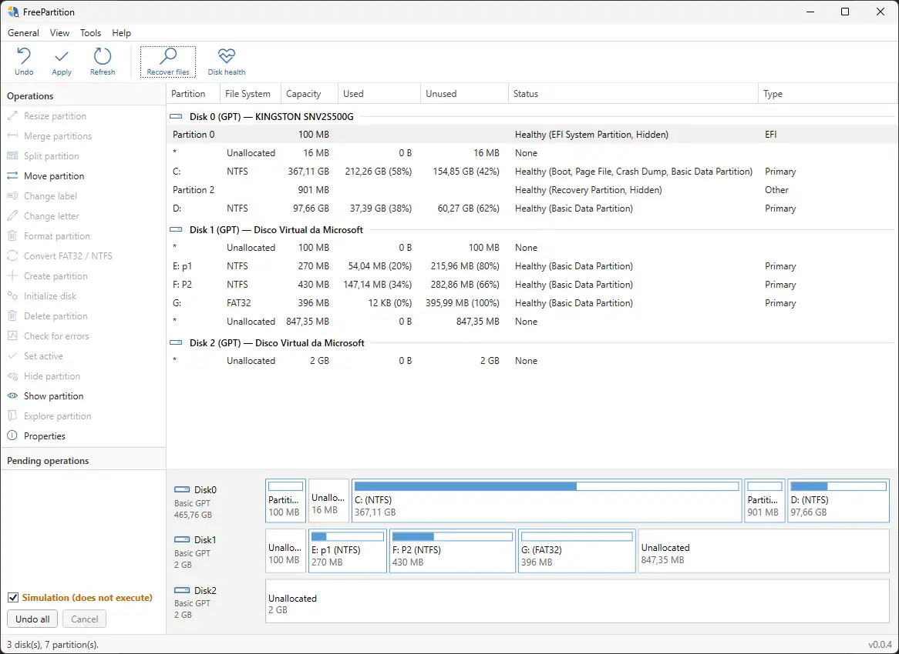
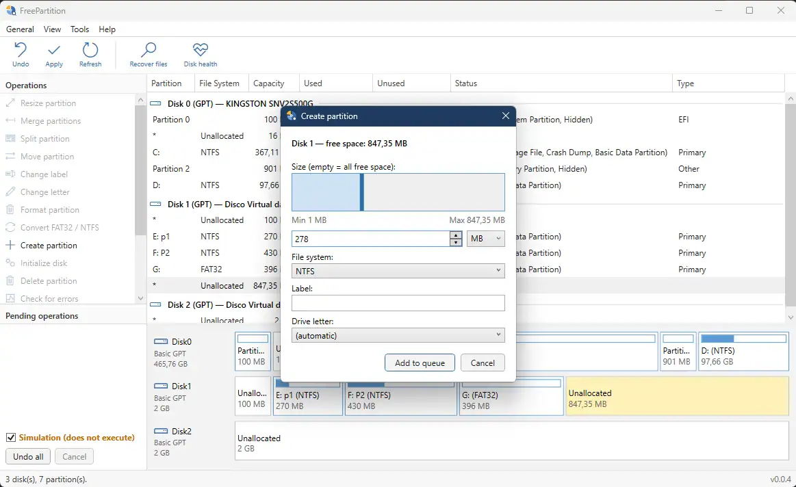
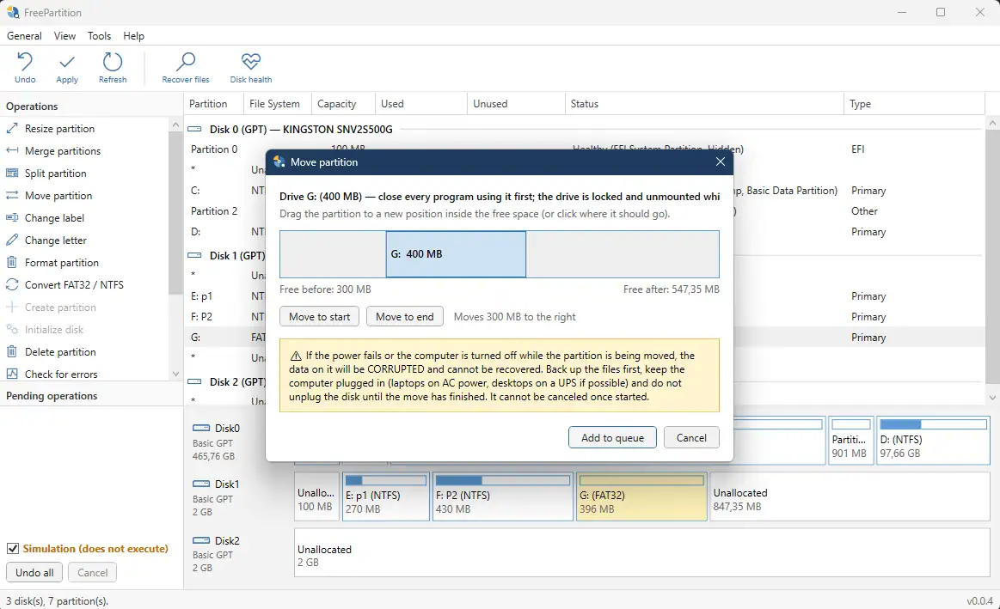
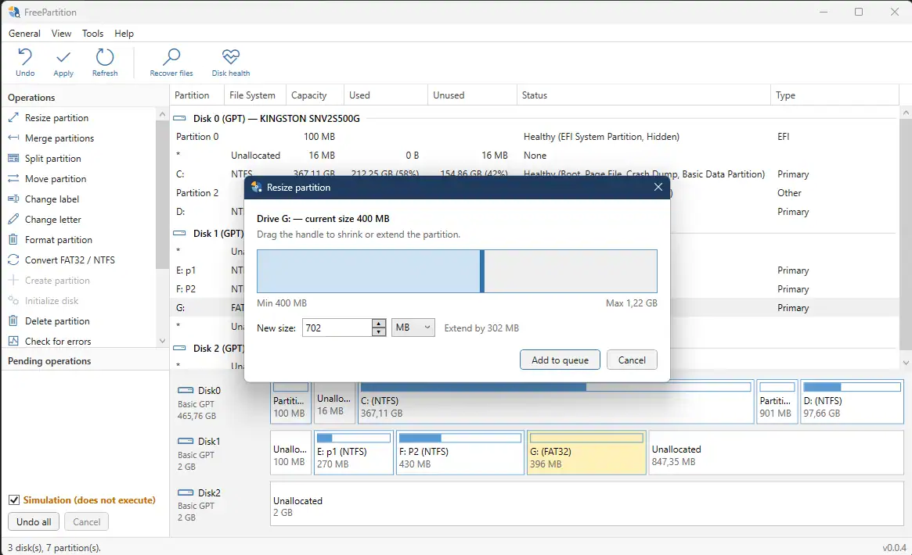
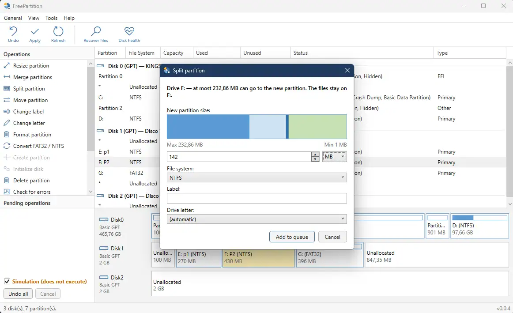
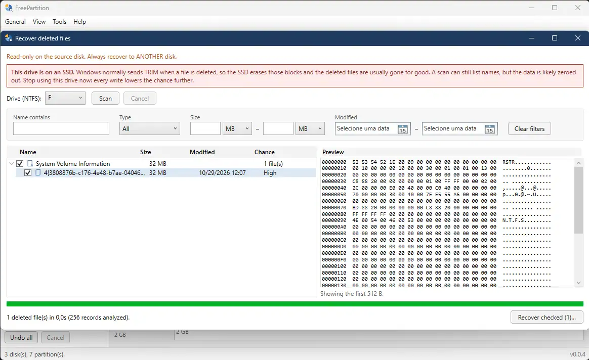
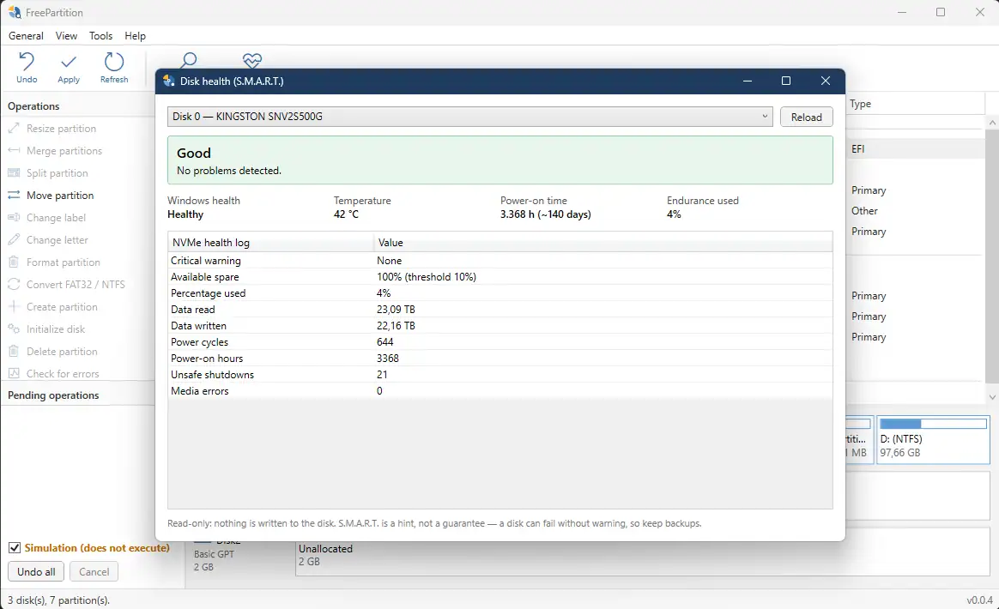

<h1 align="center">FreePartition</h1>

<p align="center">
  <b>Free, open-source disk management for Windows.</b><br>
  Manage partitions, check disk health and recover deleted NTFS files, all in one app.
</p>

<p align="center">
  Create, resize, move, merge, split and format partitions with a visual disk map and a
  review-then-apply queue, so nothing touches your disk until you confirm.<br>
  Read-only SMART and NVMe health reports, and a deleted-file scanner that recovers to another
  drive, never the one you are scanning.<br>
  Built with C# / .NET and WPF, inspired by the best disk managers available.
</p>

<p align="center">
  
  
  
  <a href="https://github.com/rfiori/FreePartition/releases"></a>
  <a href="LICENSE"></a>
  <a href="https://github.com/rfiori/FreePartition/releases"></a>
</p>

---
## Requirements

- Windows 10 / 11
- [.NET SDK 10](https://dotnet.microsoft.com/download)
- Administrator rights to run the app (raw volume access and partition)

## Quick start fo devs

```bash
git clone https://github.com/rfiori/FreePartition.git
cd FreePartition
dotnet build
dotnet test
dotnet run --project src/FreePartition.Wpf
```

The app requests elevation (UAC) on startup. If you run it from Visual Studio, open
Visual Studio **as administrator**.

<details>
<summary><b>Using a different .NET version</b></summary>

The default target is `net10.0-windows`, set in a single place. Edit `TargetFramework` in
[`Directory.Build.props`](Directory.Build.props), for example to `net8.0-windows`.

</details>

<details>
<summary><b>If your tooling does not support the <code>.slnx</code> solution format</b></summary>

`.slnx` needs Visual Studio 2022 17.13+ or a recent `dotnet`. To generate a classic `.sln`:

```bash
dotnet new sln --format sln -n FreePartition
dotnet sln add src/FreePartition.Core src/FreePartition.Wpf tests/FreePartition.Tests
```

</details>
---

## Table of contents

- [What it does](#what-it-does)
- [Screenshots](#screenshots)
- [Releases](#releases)
- [How to try it safely (test VHD)](#how-to-try-it-safely-test-vhd)
- [How recovery works](#how-recovery-works)
- [Safety](#safety)
- [Roadmap](#roadmap)
- [Known limitations](#known-limitations)
- [Contributing](#contributing)
- [License](#license)

## What it does

Everything in the **Operations** panel (and the right-click menu, which mirrors it) and the **Tools** menu is listed below. Nothing that changes a disk runs until you click **Apply**.

### Overview

| Area | Feature |
| --- | --- |
| **Disks and partitions** | Lists disks, partitions and volumes through WMI, grouped by disk with a graphical map. Tells SSDs from HDDs, flags partitions that are not aligned to 4 KB and draws the hidden Microsoft Reserved (MSR) partition as *Reserved (MSR)* instead of unallocated space. |


### Operations

**Inspect** (read-only)

| Operation | What it does |
| --- | --- |
| **Explore partition** | Opens the selected partition in Windows Explorer. |
| **Properties** | Usage bar (used/free, and on a drive with Windows the estimated share of the operating system, programs and users) plus partition, NTFS volume and disk details. |
| **Verify wipe** | Reads a whole volume (also a RAW one) and checks that nothing is left after a wipe: counts the bytes that are not zero, shows where the first one is with a hex dump and names any NTFS / exFAT / FAT32 signature that survived. Verdict: all zeros, random-looking, residual data or inconclusive. |
| **Cluster map** | Draws a whole volume (also a RAW one) as a grid. Each square is classified as zero, data or unreadable from three 4 KB samples; clicking a square shows its byte range, its NTFS clusters and a hex dump. |
| **Recover files** | Looks for deleted files on the selected NTFS drive, or carves files by signature on FAT/exFAT and damaged NTFS (see below). |
| **Recover partitions** | Looks in the unallocated space of the selected disk for NTFS, FAT32 and exFAT partitions missing from the partition table (read-only) and queues the ones you check to be put back. Only the table is written, never the files (see below). |

**Create**

| Operation | What it does |
| --- | --- |
| **Initialize disk** | Initializes a blank disk as MBR or GPT. |
| **Create partition** | Creates a partition in the selected unallocated space, formatted as NTFS, FAT32 or exFAT, with a label and drive letter. |

**Size and position**

| Operation | What it does |
| --- | --- |
| **Resize partition** | Extends or shrinks the selected partition by dragging the partition bar. |
| **Move partition** | Moves the partition into free space on the same disk (data is lost if interrupted). |
| **Align partition** | Moves a partition that is not aligned to 4 KB to the nearest 1 MB boundary (data is lost if interrupted). |
| **Merge partitions** | Merges the selected partition into the one right before it; its files are kept in a folder. |
| **Split partition** | Splits the selected partition in two, using its free space, by dragging the bar. The files stay on the original drive. |

**Settings**

| Operation | What it does |
| --- | --- |
| **Change label** | Changes the volume label. |
| **Change letter** | Changes the drive letter. |
| **Convert FAT32 / NTFS** | Converts the selected partition between FAT32 and NTFS, keeping its files. |
| **Set active** | Marks the selected MBR partition as active (bootable). |
| **Hide partition** | Removes the drive letter; the data stays untouched. |
| **Show partition** | Gives a drive letter to a hidden partition. |

**Maintenance**

| Operation | What it does |
| --- | --- |
| **Check for errors** | Checks the selected volume for file system errors with `chkdsk` (scan or repair). |

**Destructive**

| Operation | What it does |
| --- | --- |
| **Format partition** | Formats the partition as NTFS, FAT32 or exFAT. Erases all data on it. |
| **Delete partition** | Deletes the partition. Erases all data on it. |
| **Wipe free space** | Overwrites the free space of the selected drive so deleted files cannot be recovered. The files are kept. |
| **Wipe partition** | Overwrites every sector of the selected partition so nothing on it can be recovered. |
| **Wipe disk** | Deletes every partition of the selected disk and overwrites all of its sectors. |

### Tools

| Tool | What it does |
| --- | --- |
| **Recover deleted files** (Tools menu and toolbar) | MFT scan of NTFS volumes: original path, recovery chance (cross-checked against `$Bitmap`, and marked *Overwritten (zeros)* when the start, middle and end of the file are all zeros, as after a wipe; those files cannot be checked for recovery) and recovery to another drive. Results are a folder tree with check boxes that recreates the original folders, with filters by name, type, size and modified date and a read-only preview (image, text or hex dump) of the selected file. Shows a TRIM warning when the drive is on an SSD. |
| **Disk health (S.M.A.R.T.)** (Tools menu and toolbar) | Read-only report per disk: overall level, temperature, power-on time and wear, with the ATA S.M.A.R.T. attribute table or the NVMe health log. |

Not implemented yet: SSD firmware Secure Erase, clone partition, MBR ↔ GPT conversion, Windows migration and boot repair. See the [Roadmap](#roadmap).

## Screenshots



<table>
  <tr>
    <td></td>
    <td></td>
    <td></td>
  </tr>
  <tr>
    <td></td>
    <td></td>
    <td></td>
  </tr>
</table>

## Releases

Pushing a tag such as `v0.0.5` runs [the release workflow](.github/workflows/release.yml): it runs
the tests (a failure blocks the release), publishes two builds and attaches them to a GitHub
release with a `SHA256SUMS.txt` file.

- `FreePartition-<version>-win-x64.zip` — small, needs the .NET Desktop Runtime installed.
- `FreePartition-<version>-win-x64-self-contained.zip` — larger, runs without installing .NET.

Verify a download with `Get-FileHash <file>.zip -Algorithm SHA256` and compare it to `SHA256SUMS.txt`.
The builds are not code-signed yet, so Windows SmartScreen may warn on first run.

## How to try it safely (test VHD)

Run in an **elevated** PowerShell. This creates a throwaway 2 GB NTFS disk you can scan,
format and delete files on without risking real data:

```powershell
$vhd = "$env:USERPROFILE\FreePartition-test.vhdx"
New-VHD -Path $vhd -SizeBytes 2GB -Dynamic |
  Mount-VHD -Passthru |
  Initialize-Disk -PartitionStyle GPT -PassThru |
  New-Partition -UseMaximumSize -AssignDriveLetter |
  Format-Volume -FileSystem NTFS -NewFileSystemLabel FreePartition_TEST -Confirm:$false
```

Copy some files to the new drive, delete them, then scan that volume in FreePartition.
When you are done: `Dismount-VHD -Path $vhd` and delete the file.

> `New-VHD` comes from the Hyper-V PowerShell module. Without it, create the VHD from
> **Disk Management → Action → Create VHD**.

## How recovery works

1. Reads the boot sector → cluster size and where the MFT starts.
2. Reads record 0 (`$MFT`) and follows its *data runs*, so a fragmented MFT works too.
3. For each record: applies the *fixups*, reads `$FILE_NAME` (name and parent folder) and
   `$DATA`. Records without the "in use" flag are deleted files.
4. Rebuilds the original path from the parent folders (in use or deleted).
5. Cross-checks the file's clusters against `$Bitmap`: clusters still free = data probably intact.
6. Recover = copy the clusters (or the content resident in the MFT) to a file on **another disk**.

### File carving

The **Carve files by signature** option in the recovery window ignores the file system and walks the whole
volume sector by sector, looking for the bytes each format starts with, then works out where each file ends
from its own structure:

| Kind | Formats | How the end is found |
|---|---|---|
| Images | JPEG, PNG, GIF, BMP, WebP, PSD/PSB | Marker/chunk/block walk, or the size in the header |
| Documents | PDF, DOCX/XLSX/PPTX, ZIP | Last `%%EOF`, or the ZIP end record checked against its directory |
| Media | MP4, MOV, M4A, 3GP, HEIC, AVIF, WAV, AVI | Chain of boxes, or the RIFF size |
| Other | 7z, SQLite, EXE/DLL | Size in the header (7z checked by its CRC), or the last section and signature (PE) |

It is on by default for FAT/exFAT drives, and the scan switches to it by itself when the NTFS MFT cannot be read.

- Files come back as `carved_00001.jpg`, grouped by type, without their original names, folders or dates.
- A fragmented file is cut at the first gap, so it may be incomplete or damaged.
- A file whose end has to be searched for (JPEG, PNG, GIF, PDF, ZIP) is skipped past 256 MiB; formats that state their
  own size (video, audio, 7z, SQLite) go up to 16 GiB. Data appended to an EXE/DLL (installers) is not included.
- It reads the entire drive, so it is much slower than the MFT scan. The volume is still opened read-only.
  **Cancel** stops the scan and lists everything found so far, so a long scan can be cut short and still be useful.

### Lost partitions

**Recover partitions** (Tools menu, Operations panel, or right-click; pick the disk in the window) finds partitions
whose entry is gone from the partition table, for example after a deleted partition, a corrupted table or a disk that
shows as uninitialized:

1. Works out the unallocated ranges of the disk from the partitions Windows reports (the GPT tables are left out).
2. Looks in those ranges for the boot sector of an NTFS, FAT32 or exFAT volume. A sector counts only if its signature,
   boot mark and the size fields the file system requires are all in range.
3. Reads the volume size from the boot sector and keeps only partitions that fit entirely in the free space.
4. Looks at the backup boot sector at the end of the volume. If it matches, the result is **high confidence** and
   checked by default; a partition with only the first boot sector is **low confidence** and left unchecked.
5. **Add to queue** queues a *Restore partition* for each checked result. On **Apply** it re-reads the boot sector (it
   must still be the same file system and size), checks that nothing else occupies the range and adds the partition
   to the table by writing the entry directly (`New-Partition` is not used: it zeroes the start of the new partition and
   would destroy the boot sector). The volume is **not formatted**, so its files come back as they were.

- **Quick** looks where partitions usually start: the start of each free range, every 1 MB, and the track and
  cylinder boundaries of old Windows layouts (sector 63). **Deep** reads every sector of the free space, so it finds
  partitions that start anywhere but takes as long as copying that space. **Cancel** lists what was found so far.
- On a disk with no partition table, queue **Initialize disk** first (MBR or GPT, it writes only the table), then the restores.
- It only restores the partition, not the type or GUID: Windows gives it a new GPT GUID and a basic data type.

## Safety

The guarantees the code is built around:

- The volume is opened **read-only** — nothing is written to the source disk during a scan.
- Recovery **refuses a destination folder on the same drive** as the file being recovered.
- Disk operations never run directly: they go into a queue and only run on **Apply**, after an
  explicit confirmation that lists the risk.
- **Simulation mode is checked by default** — it shows the commands without running anything.
- Formatting or changing the drive letter of the **Windows drive** is blocked.
- PowerShell scripts are generated only from validated values (drive letter, numeric size,
  file system from a closed list, label with restricted characters) — no command injection.
- **Move partition, Restore partition and the wipe operations are the only exceptions to "nothing is written outside the PowerShell
  cmdlets"**, because Windows has no cmdlet for them. Move partition exists because no cmdlet changes where a partition starts. It only runs after **Apply**, never on the Windows drive,
  only inside the partition's own space plus free space of the same disk (the table is checked first, and the drive
  letter must be exactly the selected partition), with the volume locked and unmounted. If the partition table
  cannot be updated after the copy, the data is copied back. **If the power fails or the computer is turned off
  while it runs, the data on that partition is corrupted** — the app says so before and when applying, and it
  cannot be canceled once the copy has started.
- **Wipe** (partition, free space, whole disk) only runs after **Apply**, after typing the drive letter or disk
  number to confirm. It is refused on the Windows drive, and *Wipe disk* on any disk holding the Windows drive or
  the app itself — checked by the queue, by the script (`IsSystem`/`IsBoot`) and again right before writing, failing
  closed if the disk cannot be identified. A partition is overwritten through its own locked volume, so no write can
  land outside it. Writes are sector-aligned. On SSDs the app warns that overwriting cannot reach the drive's spare
  cells.
- The lost-partition scan only reads the disk. **Restore partition** writes nothing but a partition table entry, only
  after **Apply**, refuses a range that overlaps an existing partition or no longer holds the same boot sector, and
  never formats.
- The queue stops at the first failure; the remaining operations stay pending.
- **Undo** only works before applying. An applied operation is **not** reversible.
- Every event is logged to `%LocalAppData%\FreePartition\operations.log`.

## Roadmap

**Basic**
- ✅ List disks, partitions and volumes
- ✅ Format (NTFS, FAT32, exFAT)
- ✅ Shrink and extend partition
- ✅ Change drive letter and label
- ✅ Create and delete partition
- ✅ Initialize disk (MBR/GPT)
- ✅ Set active partition, hide/show
- ✅ Disk health (S.M.A.R.T.)

**Intermediate**
- ✅ Pending-operations queue (Apply/Undo)
- ✅ Operations log
- ✅ Merge and split partitions
- ✅ Convert FAT32 ↔ NTFS without data loss (not yet run on a real disk; test on a VHD first)
- ✅ Check for errors (`chkdsk`; scan or repair)
- ✅ Detect partitions not aligned to 4 KB (warning on the disk map and in Properties)
- ✅ Align a partition to 1 MB (moves it to the nearest boundary; same risk as a move, not yet run on a VHD)
- ✅ Wipe a partition, a whole disk or a drive's free space (zeros, verified zeros or random data; not yet run on a VHD)

**Data recovery**
- ✅ Find deleted files (MFT scan, NTFS)
- ✅ Recovery chance estimate
- ✅ Always recover to another disk
- ✅ Filter by name
- ✅ Filters by type, size and date; preview before recovering (image, text or hex dump)
- ✅ File carving by signature (JPEG, PNG, PDF, DOCX…) for FAT/exFAT or a damaged MFT
- ✅ Recover lost partitions (NTFS, FAT32, exFAT by boot sector; not yet run on a VHD)
- ✅ Explicit TRIM warning on SSD

**Advanced (high risk — needs heavy VM/VHD testing)**
- ✅ Move partition (same disk, into free space; verified on a VHD, not yet on a physical disk)
- ⚪ Clone partition
- ⚪ Convert MBR ↔ GPT without data loss
- ⚪ Migrate Windows to another SSD/HDD
- ⚪ Rebuild MBR/BCD, bootable media (WinPE)

## Known limitations

- **Names and folders need NTFS.** FAT/exFAT only have *file carving* (no names, folders or dates, a handful of formats);
  reading their directory entries (`0xE5`) is not implemented. Carving has never run on a real volume yet: test it on a VHD first.
- **Lost partitions** are found by their first boot sector only. A partition whose boot sector was overwritten, FAT12/16,
  ReFS, Linux and other file systems are not found. A partition that overlaps one you created afterwards is not listed.
  Logical partitions inside an MBR extended
  partition come back as primary ones. The scan has never run on a real disk: test it on a VHD first.
- Files with an `$ATTRIBUTE_LIST` (very fragmented, or with many attributes) may appear incomplete.
- Compressed or encrypted (EFS) files are marked "Unavailable".
- Alternate data streams (ADS) are ignored.
- The sequence number of the parent reference is not validated — paths of reused folders may be wrong.
- On SSDs with TRIM, deleted data has usually already been discarded by the controller.
- Move partition: same disk only, MBR (without extended partitions) and GPT, destinations aligned to 4 KB, and the
  partition needs a drive letter. **Align partition** uses the same move, so it needs up to 1 MB of free space
  right before or after the partition. You drag the partition inside the free space touching it (before and/or after), in steps of 1 MiB.
  Boot-sector "hidden sectors" are not rewritten, so the app asks for confirmation when the partition is marked
  Boot, Active, Page File or Crash Dump, and refuses the Windows drive outright.
- Convert FAT32 ↔ NTFS: FAT32 → NTFS runs Windows' in-place `convert.exe`. NTFS → FAT32 has no in-place tool, so the
  files are copied to another drive, verified (file count and bytes), the volume is formatted and the files are copied
  back and verified again; the copy is deleted only then. It needs free space on another drive, refuses volumes over
  32 GB (the Windows FAT32 format limit) and files of 4 GB or more, and FAT32 loses NTFS permissions, compression,
  encryption, alternate data streams and hard links. Never on the Windows drive. If the power fails after the format
  starts, the files are in `\FreePartition_Convert_<drive>` on the staging drive.
- The partition "Type" column only shows Primary / EFI / Other: WMI does not distinguish logical partitions.
- The UI is code-behind (no MVVM yet).

## Contributing

Issues and pull requests are welcome.

- Everything in the repository is written in **US English**: identifiers, comments, UI text,
  log messages, tests, docs and commit messages.
- Keep the logic in `FreePartition.Core` and testable without a real disk; the UI only calls Core.
- `dotnet build` must produce no new warnings, and `dotnet test` must pass.
- Any new binary-format parser needs unit tests with hand-built records, including invalid cases
  (see `MftParserTests` for the pattern).
- Never test destructive operations on a real disk — use a VHD or a VM.

## License

MIT — see [LICENSE](LICENSE).

Privacy policy: [English](docs/privacy/PRIVACY.md) · [Español](docs/privacy/PRIVACY.es.md) ·
[Português (Brasil)](docs/privacy/PRIVACY.pt-BR.md). FreePartition collects no data and makes no network connections.

FreePartition is an independent project and is not affiliated with any company.
