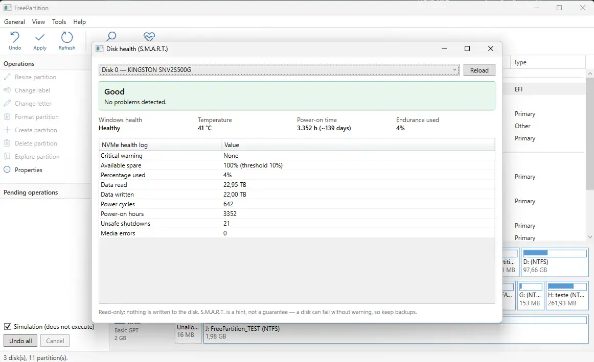

<h1 align="center">FreePartition</h1>

<p align="center">
  A free disk partition manager for Windows, with NTFS deleted-file recovery.<br>
  Built in C# / .NET and WPF, inspired by EaseUS Partition Master.
</p>

<p align="center">
  
  
  
  
</p>

> [!WARNING]
> **Alpha software that touches disks.** The MFT scan has not yet been validated on real
> hardware, and the partition operations run real PowerShell cmdlets. Try it on a **test VHD
> or a virtual machine first**, and keep backups. See [Safety](#safety) and
> [Known limitations](#known-limitations).

---

## Table of contents

- [What it does](#what-it-does)
- [Screenshots](#screenshots)
- [Requirements](#requirements)
- [Quick start](#quick-start)
- [How to try it safely (test VHD)](#how-to-try-it-safely-test-vhd)
- [How recovery works](#how-recovery-works)
- [Safety](#safety)
- [Project structure](#project-structure)
- [Roadmap](#roadmap)
- [Known limitations](#known-limitations)
- [Contributing](#contributing)
- [License](#license)

## What it does

| Area | Feature |
| --- | --- |
| **Disks and partitions** | Lists disks, partitions and volumes through WMI, grouped by disk with a graphical map. |
| **Deleted-file recovery** | MFT scan of NTFS volumes: original path, recovery chance (cross-checked against `$Bitmap`) and recovery to another drive, browsing results as a folder tree and recreating the original folders. |
| **Partition operations** | Resize/extend (drag the partition bar), create and delete partitions, format (NTFS, FAT32, exFAT), change label, change drive letter, set active (MBR), hide/show, check for errors. Also available from the right-click menu. |
| **Disk health** | Read-only S.M.A.R.T. report per disk (Tools → Disk health): overall level, temperature, power-on time, wear and the ATA attribute table. |
| **Pending-operations queue** | Nothing runs until you click **Apply**: *Undo / Undo all / Apply / Simulation*, plus a log in `%LocalAppData%\FreePartition\operations.log`. |

Not implemented yet: move partition, clone disk, MBR ↔ GPT conversion. See the [Roadmap](#roadmap).

## Screenshots




## Requirements

- Windows 10 / 11 (the project uses WMI, P/Invoke, PowerShell and WPF — Windows only).
- [.NET SDK 10](https://dotnet.microsoft.com/download) (or change the target, see below).
- Administrator rights to run the app (raw volume access and partition cmdlets).

## Quick start

```bash
git clone https://github.com/rfiori/FreePartition.git
cd FreePartition
dotnet build
dotnet test
dotnet run --project src/FreePartition.Wpf
```

The app requests elevation (UAC) on startup. If you run it from Visual Studio, open
Visual Studio **as administrator**.

<details>
<summary><b>Using a different .NET version</b></summary>

The default target is `net10.0-windows`, set in a single place. Edit `TargetFramework` in
[`Directory.Build.props`](Directory.Build.props), for example to `net8.0-windows`.

</details>

<details>
<summary><b>If your tooling does not support the <code>.slnx</code> solution format</b></summary>

`.slnx` needs Visual Studio 2022 17.13+ or a recent `dotnet`. To generate a classic `.sln`:

```bash
dotnet new sln --format sln -n FreePartition
dotnet sln add src/FreePartition.Core src/FreePartition.Wpf tests/FreePartition.Tests
```

</details>

## How to try it safely (test VHD)

Run in an **elevated** PowerShell. This creates a throwaway 2 GB NTFS disk you can scan,
format and delete files on without risking real data:

```powershell
$vhd = "$env:USERPROFILE\FreePartition-test.vhdx"
New-VHD -Path $vhd -SizeBytes 2GB -Dynamic |
  Mount-VHD -Passthru |
  Initialize-Disk -PartitionStyle GPT -PassThru |
  New-Partition -UseMaximumSize -AssignDriveLetter |
  Format-Volume -FileSystem NTFS -NewFileSystemLabel FreePartition_TEST -Confirm:$false
```

Copy some files to the new drive, delete them, then scan that volume in FreePartition.
When you are done: `Dismount-VHD -Path $vhd` and delete the file.

> `New-VHD` comes from the Hyper-V PowerShell module. Without it, create the VHD from
> **Disk Management → Action → Create VHD**.

## How recovery works

1. Reads the boot sector → cluster size and where the MFT starts.
2. Reads record 0 (`$MFT`) and follows its *data runs*, so a fragmented MFT works too.
3. For each record: applies the *fixups*, reads `$FILE_NAME` (name and parent folder) and
   `$DATA`. Records without the "in use" flag are deleted files.
4. Rebuilds the original path from the parent folders (in use or deleted).
5. Cross-checks the file's clusters against `$Bitmap`: clusters still free = data probably intact.
6. Recover = copy the clusters (or the content resident in the MFT) to a file on **another disk**.

## Safety

The guarantees the code is built around:

- The volume is opened **read-only** — nothing is written to the source disk during a scan.
- Recovery **refuses a destination folder on the same drive** as the file being recovered.
- Disk operations never run directly: they go into a queue and only run on **Apply**, after an
  explicit confirmation that lists the risk.
- **Simulation mode is checked by default** — it shows the commands without running anything.
- Formatting or changing the drive letter of the **Windows drive** is blocked.
- PowerShell scripts are generated only from validated values (drive letter, numeric size,
  file system from a closed list, label with restricted characters) — no command injection.
- The queue stops at the first failure; the remaining operations stay pending.
- **Undo** only works before applying. An applied operation is **not** reversible.
- Every event is logged to `%LocalAppData%\FreePartition\operations.log`.

## Project structure

```
FreePartition.slnx                     # the solution
Directory.Build.props                  # TargetFramework and shared options
src/FreePartition.Core/                # all logic, no UI, testable without a real disk
  Disks/       DiskService (WMI), DiskHealthService (S.M.A.R.T.), RawVolume (reads \\.\C:), Models
  Ntfs/        NtfsBootSector, MftParser, RunReader, DeletedFileScanner, FileRecoverer
  Operations/  DiskOperation (+ types), OperationQueue, PowerShellExecutor, OperationLog
  Util/        ByteFormatter
src/FreePartition.Wpf/                 # WPF UI (app.manifest: requireAdministrator)
tests/FreePartition.Tests/             # xUnit tests (synthetic MFT records, fake executor)
```

## Roadmap

**Basic**
- [x] List disks, partitions and volumes
- [x] Format (NTFS, FAT32, exFAT)
- [x] Shrink and extend partition
- [x] Change drive letter and label
- [x] Create and delete partition
- [x] Initialize disk (MBR/GPT)
- [x] Set active partition, hide/show
- [x] Disk health (S.M.A.R.T.)

**Intermediate**
- [x] Pending-operations queue (Apply/Undo)
- [x] Operations log
- [ ] Merge and split partitions
- [ ] Convert FAT32 ↔ NTFS without data loss
- [x] Check for errors (`chkdsk`; scan or repair)
- [ ] Securely wipe a disk / 4K alignment for SSD

**Data recovery**
- [x] Find deleted files (MFT scan, NTFS)
- [x] Recovery chance estimate
- [x] Always recover to another disk
- [x] Filter by name
- [ ] Filters by type, size and date; preview before recovering
- [ ] File carving by signature (JPEG, PNG, PDF, DOCX…) for FAT/exFAT or a damaged MFT
- [ ] Recover lost partitions
- [x] Explicit TRIM warning on SSD

**Advanced (high risk — needs heavy VM/VHD testing)**
- [ ] Move partition, clone partition or disk
- [ ] Convert MBR ↔ GPT without data loss
- [ ] Migrate Windows to another SSD/HDD
- [ ] Rebuild MBR/BCD, bootable media (WinPE)

## Known limitations

- **NTFS only.** FAT/exFAT need another routine (directory entries with `0xE5`) and/or *file carving*.
- Files with an `$ATTRIBUTE_LIST` (very fragmented, or with many attributes) may appear incomplete.
- Compressed or encrypted (EFS) files are marked "Unavailable".
- Alternate data streams (ADS) are ignored.
- The sequence number of the parent reference is not validated — paths of reused folders may be wrong.
- On SSDs with TRIM, deleted data has usually already been discarded by the controller.
- The partition "Type" column only shows Primary / EFI / Other: WMI does not distinguish logical partitions.
- The UI is code-behind (no MVVM yet).

## Contributing

Issues and pull requests are welcome.

- Everything in the repository is written in **US English**: identifiers, comments, UI text,
  log messages, tests, docs and commit messages.
- Keep the logic in `FreePartition.Core` and testable without a real disk; the UI only calls Core.
- `dotnet build` must produce no new warnings, and `dotnet test` must pass.
- Any new binary-format parser needs unit tests with hand-built records, including invalid cases
  (see `MftParserTests` for the pattern).
- Never test destructive operations on a real disk — use a VHD or a VM.

## License

MIT — see [LICENSE](LICENSE).

FreePartition is an independent project and is not affiliated with EaseUS.
